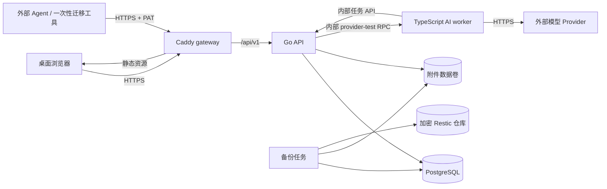

# 开发百宝箱一期系统架构

状态：**已完成并关闭，作为 `v1.0.0` 的冻结架构记录**

## 1. 架构目标

一期架构只为当前闭环服务：单用户、自托管、快速记录与搜索、附件、受控 AI 任务、外部 Agent API 和可恢复部署。

关键目标：

- 核心记录能力不依赖 AI worker。
- 原始记录、派生结果和显示层依赖方向单一。
- 使用最少的运行组件完成公网部署。
- 未来增加小工具时复用同一身份、设置和应用外壳，但不提前建设插件平台。
- 运行数据明确落在 PostgreSQL 和附件卷中，备份范围清楚。

## 2. 运行时组件

一期固定为四个容器：

| 容器 | 职责 | 公网端口 |
|---|---|---:|
| `gateway` | Caddy、静态 Web、反向代理 `/api`；默认同时终止 TLS | 默认 80、443；外置 Nginx 模式无宿主机端口 |
| `api` | Go HTTP API、认证、业务规则、搜索、数据访问、任务调度 | 无 |
| `ai-worker` | TypeScript 模型适配、受控 Agent Loop、JSON Schema 结果生成 | 无 |
| `postgres` | 唯一业务数据库 | 无 |

附件不是独立服务，由 `api` 容器访问映射卷。`ai-worker` 通过内部 API 获取任务输入和授权附件，不直接挂载整个附件卷。



### 2.1 为什么不增加 Redis 或消息队列

AI 任务规模是单用户、低并发。任务记录存 PostgreSQL，worker 通过内部 claim API 获取待处理任务即可。API 使用数据库事务保证同一任务只被一个 worker 领取。

只有在一期上线后出现以下真实证据时才重新评估队列：

- 单 worker 无法满足已测量的并发需求。
- PostgreSQL 任务表对正常搜索/录入造成可重复的资源争用。
- 需要多个独立消费者并且数据库 claim 无法表达必要语义。

### 2.2 为什么不增加 MinIO

一期只有一个 API 实例和一个部署主机，附件直接落在映射卷：

- 路径简单。
- 恢复范围明确。
- 避免新增凭据、服务、升级和备份对象。

未来需要多实例、对象存储或异地直接下载时，再通过 `BlobStore` 接口引入 S3 适配；一期只有文件系统实现，不创建没有第二个消费者的复杂抽象层。

## 3. 系统边界

### 3.1 公网边界

- 默认只有 Caddy 监听宿主机 80/443。部署主机已经运行受控 Nginx 时，允许它作为唯一公网 TLS 边缘；gateway 不映射宿主机端口，只加入该 Nginx 已有的 Docker 网络。
- `/` 提供 Web 静态文件。
- `/api/v1/*` 转发到 Go API。
- `/internal/*` 不在 Caddy 路由中，外部无法访问。
- PostgreSQL 端口只在 Compose 内部网络可见，不映射宿主机端口。
- AI worker 不提供公网接口。

Caddy 直连模式在配置有效域名后负责自动证书和 HTTP→HTTPS 重定向。外置 Nginx 模式复用主机已经管理的证书与续期路径，Nginx 必须覆盖客户端传入的转发头、把请求交给唯一的 gateway 网络别名，且不得为 API、worker 或 PostgreSQL 增加宿主机端口。Caddy 的可信代理范围只在外置模式中显式开启。Caddy 自动 HTTPS 参考官方文档：<https://caddyserver.com/docs/automatic-https>。

### 3.2 信任边界

| 边界 | 信任级别 | 处理方式 |
|---|---|---|
| 浏览器 → gateway/API | 不可信输入 | 登录、会话、CSRF/Origin 校验、参数与文件校验 |
| 外部 Agent → API | 不可信客户端 | PAT 哈希、scope、速率限制、Schema 校验 |
| API → PostgreSQL | 受控内部 | 参数化 SQL、迁移管理、最小数据库账号 |
| API → 附件卷 | 受控内部 | 生成存储名、拒绝路径穿越、下载强制安全头 |
| worker → API | 受控服务 | 内部 token、仅内部网络、固定内部接口 |
| API → worker | 受控服务 | 同一内部凭据、仅单用途 Provider 连接测试 RPC、严格超时 |
| worker → Provider | 第三方服务 | TLS、超时、限额、敏感策略、响应 Schema 校验 |
| 模型输出 → 系统 | 永远不可信 | JSON 解析、Schema 校验、引用校验、无 HTML/脚本执行 |

每个独立信任边界执行一次完整校验：公共 HTTP/PAT、双向的窄内部 worker API、Provider 响应、文件上传和数据库持久化分别建立自己的不变量。边界通过后，模块内部依赖明确类型和已建立的不变量，不在 handler、service、repository 等每一层机械重复同一套业务校验；数据库约束仍独立保护真实数据完整性。

## 4. Go API：模块化单体

### 4.1 模块划分

```text
apps/api/internal/
├── auth/          登录、TOTP、可信设备、会话、PAT
├── knowledge/     知识条目、原始记录、目录、标签、回收站
├── attachment/    上传、下载、元数据、缩略图协调
├── search/        分片、索引、查询、排序和高亮
├── ai/            Provider 配置、任务、派生版本、内部 worker API
├── settings/      单实例设置
├── operations/    健康检查、备份状态、版本信息
└── platform/      数据库、HTTP、日志、时钟、ID、配置等技术适配
```

模块原则：

- `knowledge` 不依赖 `ai`；没有 AI 时知识模块完整运行。
- `ai` 可以读取 `knowledge` 暴露的查询接口，不能调用原始记录更新接口。
- `search` 只通过知识/派生模块的显式同步调用更新索引，不能反向改变业务数据。
- `attachment` 管理二进制生命周期，知识模块只保存附件引用。
- `auth` 不理解知识业务，只提供主体和授权结果。
- `platform` 只放有明确基础设施语义的适配，不成为业务杂物箱。

### 4.2 模块通信

一期使用进程内显式接口和同步调用，不引入通用事件总线框架。

下面几类变化有真实搜索消费者：

- 原始记录创建 → 创建搜索片段。
- 人工元数据改变 → 刷新对应搜索字段。
- artifact 激活 → 切换 AI 派生搜索内容。
- 条目永久删除 → 清理搜索片段。

这些更新通过显式服务调用完成，并与对应业务数据写入同一个 PostgreSQL 事务；不定义事件对象、发布器、订阅器或 `index_state` 状态机。若升级或人工恢复导致索引不一致，受控的全量重建命令从原始数据重新生成；原始片段使用版本化稳定 ID，历史 artifact 引用的旧片段不能被重建命令删除。缩略图等非核心派生文件可以在提交后生成，失败不影响原图。

### 4.3 数据访问

- 业务 SQL 由对应模块拥有。
- 数据库迁移按全局顺序管理，但迁移文件注明 owner 模块。
- 固定使用 `github.com/jackc/pgx/v5` 的原生接口和 `pgxpool`，业务模块手写参数化 SQL 与显式 Scan；不引入 ORM、`database/sql` Repository 包装或 sqlc 双轨。
- 固定使用 `github.com/jackc/tern/v2` 管理顺序 SQL migration；只使用 PostgreSQL 迁移能力，不启用 SSH tunnel、模板环境取 Secret 或 Go 数据迁移插件。
- 普通 schema 迁移写 SQL；确需大数据变换时创建受控管理命令并分批执行，不把复杂业务写进 migration 模板。
- 所有时间使用 `timestamptz`，服务端统一 UTC，前端按用户时区显示。
- 所有 API ID 使用 UUID；顺序依赖显式时间字段，不依赖 UUID 排序。

## 5. Web 应用架构

### 5.1 模块

```text
apps/web/src/
├── app/                 路由、应用壳、全局 Provider
├── modules/
│   ├── knowledge/       一期知识与记录模块
│   ├── settings/        安全、Provider、外观、Token
│   └── future-tools/    不创建；未来按确认需求新增具体模块
├── components/
│   ├── ui/              基础可访问组件
│   ├── content-blocks/  AI block 渲染器
│   └── shell/           导航、全局搜索、三栏布局
├── design/              tokens、主题与全局样式
├── api/                 生成/手写的 API client 与错误映射
└── shared/              仅限真实跨模块类型和无业务状态函数
```

### 5.2 状态管理

- API client 使用浏览器原生 `fetch` + `AbortController` 和模块级 composable；一期不引入 Axios、TanStack Query 或另一套请求缓存框架。
- 只缓存页面确有复用的字典/设置数据；记录详情和搜索结果由路由/查询状态驱动，失效后明确重新请求，不自制通用归一化实体缓存。
- 只把跨页面且确实需要的客户端状态放入 Pinia：主题、布局宽度和当前标签页内的临时搜索会话等。原始搜索词不持久化，也不进入 URL；只有非敏感视图、过滤器和排序进入路由状态。
- 表单局部状态留在组件内。
- 不把整个服务端实体树复制到一个全局 Store。

### 5.3 内容渲染安全

- 原始 Markdown 使用固定 Markdown 渲染器与白名单策略。
- 模型不能输出可执行 HTML；AI 结果只通过 block renderer。
- 代码块按纯文本渲染，高亮库不得执行代码。
- 外部链接默认新标签打开并加安全 `rel`。
- SVG/HTML 等上传文件作为附件下载，不以内联活动内容方式展示。

## 6. AI worker 架构

### 6.1 采用的分层

参考 `dg-ai-notes` 对 Pi 的三层拆分以及 Pi 官方实现：

```text
领域任务层（开发百宝箱）
  organize_record / review_record / analyze_image
  Prompt、工具白名单、Schema、任务限制
        ↓
Agent 运行层
  有界循环、消息状态、工具调用、事件
        ↓
模型协议层
  OpenAI Chat / Responses / Anthropic Messages / 自定义 Base URL
```

参考资料：

- <https://github.com/hxf4869/dg-ai-notes>
- <https://github.com/earendil-works/pi/tree/main/packages/agent>
- <https://github.com/earendil-works/pi/tree/main/packages/ai>

一期决定：

- 优先直接使用并封装 `@earendil-works/pi-ai` 与 `@earendil-works/pi-agent-core`，在 lockfile 中固定实际采用版本。
- 不使用 `pi-coding-agent`、TUI、orchestrator 或其 Shell/read/edit/write 工具。
- 开发百宝箱自己的接口只暴露 `ModelGateway`、`TaskRunner`、`TaskEvent` 和领域工具；业务代码不依赖 Pi 的全量类型。
- 如果实现期发现指定版本无法满足三个冻结协议，先报告具体不兼容，再决定补丁或薄适配；不得未经确认重写通用 Agent SDK。
- Provider 连接测试不是 AI 任务，不进入 Agent Loop；它通过 worker 的同一个 `ModelGateway` 只发送一次固定最小请求，不创建 task、event 或 artifact，也不在 Go API 重复实现协议 adapter。

### 6.2 一期领域工具白名单

| 工具 | 作用 | 写权限 |
|---|---|---|
| `get_record_context` | 获取当前任务授权的原始文本、片段和元数据 | 无 |
| `get_attachment` | 获取当前任务授权的单个图片附件 | 无 |
| `search_related_records` | 在限制数量内返回相关记录的安全摘要，辅助分类；不能提供可写入 artifact 的证据 ID | 无 |
| `emit_candidate_artifact` | 提交候选 JSON 结果供宿主校验 | 只能产生候选派生结果 |

工具参数必须使用 Pi 工具声明生成的 JSON Schema 校验。`recordId`、`attachmentId` 和结果引用必须属于当前任务授权集，不能由模型枚举全库；artifact 的证据引用进一步限制为当前 item 的 raw records，相关记录只作为分类上下文。不再并行维护另一套 Zod/TypeBox 契约。

任务工具集固定为：

| 任务 | 可用工具 |
|---|---|
| `organize_record` | `get_record_context`、可选 `search_related_records`、`emit_candidate_artifact` |
| `review_record` | `get_record_context`、`emit_candidate_artifact` |
| `analyze_image` | `get_record_context`、`get_attachment`、`emit_candidate_artifact` |
| `batch_organize` | 无；由 API 展开子任务，worker 不执行父任务 |

明确禁止的工具：

- Shell、SSH、命令执行。
- SQL 查询或数据库连接。
- 任意文件系统路径读写。
- 任意 URL 请求、浏览器、网页搜索。
- 修改/删除记录、附件、目录、标签或设置。
- 创建其他 Agent 或任意子任务。

### 6.3 有界循环

每个任务有固定边界，默认值可配置但不由模型修改：

- 最大模型轮次：4。
- 最大工具调用总数：8。
- 最大相关记录数：10。
- 单任务墙钟时间：5 分钟。
- Provider 网络请求需要连接和整体超时。
- 用户取消时传播 `AbortSignal`。
- 超限、取消、Provider 失败和 Schema 失败都保存稳定失败类型。
- 上下文预算先完整容纳当前条目，再按剩余预算加入最多 10 条相关摘要；当前条目本身无法完整容纳时返回 `AI_CONTEXT_TOO_LARGE`，不静默截断或自动递归总结。

一期不实现自动多模型回退。用户可以手动选择其他模型重试，以避免同一任务在未知情况下产生多份费用。

### 6.4 事件

worker 内部保留以下事件粒度：

- `task_started`。
- `model_request_started` / `model_request_finished`。
- `tool_started` / `tool_finished`。
- `candidate_received`。
- `task_succeeded` / `task_failed` / `task_cancelled`。

token 级 delta 不需要全部写数据库。UI 一期关注任务阶段而不是聊天式逐字输出；worker 可以将高频更新合并后上报。

### 6.5 任务领取协议

1. worker 使用内部凭据请求 `POST /internal/ai/tasks/claim`。
2. API 在事务中领取一个待执行的非 batch 任务并返回任务输入、当前 lease version 和解密后的 Provider 配置；`batch_organize` 由 API 展开和汇总，worker 不领取父任务。
3. worker 周期性上报状态或事件摘要。
4. worker 提交候选 JSON。
5. API 校验 Schema、来源引用和任务状态，创建不可变 artifact 版本。
6. worker 确认结束。心跳租约过期的任务最多重新排队一次；再次过期则失败。用户手动重试创建新任务并引用旧任务，不改写旧任务历史。

内部 API 不通过 gateway 暴露。所有 Provider 出站请求只由 worker 发出。Provider Key 明文仅在 API 组装 task claim 或 provider-test 内部请求、以及 worker 执行对应调用的短暂内存中存在，不写任务事件、日志或其他持久化位置。

## 7. 搜索架构

### 7.1 一期实现

PostgreSQL 启用 `pg_trgm`，以 GIN 索引支持相似度和 `LIKE/ILIKE` 类查询。该扩展由 PostgreSQL 官方提供，适合本项目的中文片段、英文词和命令子串检索：<https://www.postgresql.org/docs/current/pgtrgm.html>。

一期组合：

- 标准化文本列：保留原文，额外生成小写、统一空白的检索文本。
- `pg_trgm`：标题、文件名和片段的子串/模糊匹配。
- `to_tsvector('simple', ...)`：英文、数字和可拆分 token。
- 结构化过滤：目录、标签、类型、敏感状态、时间。
- 应用层合并权重，并返回纯文本 `snippetParts` 高亮分段，前端不拼接服务端 HTML。

一期查询按字面文本解释，没有布尔表达式、字段语法、引号/减号语法、正则或 Lucene DSL。进入 `LIKE/ILIKE` 前转义 `%`、`_` 和转义字符本身；规范化不能删除路径、命令和配置常见标点。相关性分页使用与排序完全相同的离散匹配等级、相似度、有效采集时间和 item ID 元组，cursor 只做不透明 Base64URL 编码与结构校验，不加密、签名或持久化。

### 7.2 不做向量检索

`pgvector` 可以在 PostgreSQL 中保存 embedding 并做最近邻搜索，但它仍需要稳定的 embedding 模型、维度、重建策略和成本配置。用户当前没有本地 embedding 模型，一期核心搜索不应依赖外部模型，因此不启用该扩展。

未来只有在用户明确选择 embedding Provider，并通过脱敏/费用/效果验收后才进入二期。参考项目：<https://github.com/pgvector/pgvector>。

### 7.3 AI 增强但不冒充语义搜索

成功的整理结果可以产生：

- 同义关键词。
- 内容类型。
- 目录和标签建议。
- 图片说明。

这些派生文本加入普通搜索索引，提高“磁盘挂载/扩容/迁移”等相近表达的召回率。界面仍称“搜索”，不能称“语义搜索”。

## 8. 附件存储

### 8.1 路径

```text
/data/blobs/
└── <first-two-id-chars>/
    └── <attachment-uuid>
```

- 存储名只使用系统 UUID，不使用用户文件名。
- 原始文件名只存在数据库元数据中。
- 临时上传进入同一文件系统的 `/data/tmp`，完成流式大小/MIME 校验并同步计算 SHA-256 后关闭文件。
- 开启数据库事务并写入 item/raw record/attachment/search 数据；在事务提交前把临时文件原子移动到最终 blob 路径，移动失败则回滚。
- 只有最终文件已经落位才提交数据库事务。提交失败或进程在移动后崩溃时最多留下无数据库引用的孤儿文件，不会留下指向缺失文件的已提交记录；受控完整性检查负责报告/清理孤儿。

### 8.2 下载

- 下载路由检查有效会话或 PAT scope。
- 默认 `Content-Disposition: attachment`。
- 只有确认的安全图片 MIME 可以在详情内联显示。
- 设置 `X-Content-Type-Options: nosniff` 和合适 CSP。
- Range 下载不是一期必需能力；20 MiB 上限下普通流式下载足够。

### 8.3 缩略图

- 先读取图片头部尺寸；宽或高超过 16,384 px、总像素超过 40 MP 时仍保存原件，但不在服务端解码/内联预览并记录可解释状态。
- 只为通过尺寸检查的可解码图片生成最长边 512 px 的静态缩略图；GIF 只取首帧，不生成动画派生物。
- 缩略图失败不影响原图保存。
- 缩略图可以从原图重建，不进入备份完整性判断的核心清单。

## 9. 仓库结构基线

```text
dev-toolbox/
├── AGENTS.md
├── PRODUCT.md
├── README.md
├── Makefile                         # 实现阶段创建，统一常用命令
├── pnpm-workspace.yaml              # 只管理 web 与 ai-worker
├── apps/
│   ├── api/
│   │   ├── cmd/server/
│   │   ├── internal/<modules>/
│   │   ├── migrations/
│   │   └── go.mod
│   ├── web/
│   │   ├── src/
│   │   └── package.json
│   └── ai-worker/
│       ├── src/
│       └── package.json
├── deploy/
│   ├── compose.yaml
│   ├── Caddyfile
│   ├── env.example
│   └── scripts/                     # 备份、恢复、初始化等明确脚本
├── docs/
│   ├── contracts/
│   └── ...
└── tests/
    ├── fixtures/                    # 仅脱敏/合成数据
    └── e2e/
```

约束：

- 不使用 Nx、Turborepo、Bazel 或自制构建编排器。
- 根 Makefile 只包装真实命令，不复制包管理器的复杂逻辑。
- Web 和 worker 使用同一包管理器和 lockfile。
- Go API 只有一个 module；没有第二个 Go module 时不创建 `go.work`。
- 不预建空模块目录、空接口或未来工具示例。

## 10. 未来工具扩展方式

一期只实现 `knowledge` 模块。未来新增简单工具时：

1. 在 `PRODUCT.md`/基线确认用户任务和边界。
2. 在 Web 的 `modules/<tool>` 增加路由和 UI。
3. 如需后端，在 Go 单体中增加 `internal/<tool>`。
4. 只复用身份、设置、附件等已有能力。
5. 有真实共享逻辑时再抽取公共组件。

不建设：

- 动态扫描模块。
- 插件 manifest。
- 第三方 JavaScript 执行。
- 模块独立部署。
- 跨模块消息总线。

### 10.1 V2 已确认的覆盖范围

第二期工具箱已从“未来工具”提升为确认范围。它的组件边界、懒加载、Monaco/CodeMirror 6、浏览器 Tesseract.js、Go 直连阿里云与 JSON AI 窄路径统一由 `10-V2-TOOLBOX-ARCHITECTURE.md` 覆盖定义。一期的知识模块、四服务拓扑和“不建设动态插件/新微服务”约束不变。

## 11. 架构变更触发条件

以下变化必须先更新本文并取得用户确认：

- 增加或删除运行容器。
- 引入新的数据存储、数据库扩展或消息队列。
- 让 AI worker 直接访问数据库或整个附件卷。
- 让任何模型工具具备外部网络、Shell、SSH 或写原始数据能力。
- 改变附件存储位置或备份范围。
- 将未来工具拆成独立服务。
- 启用 embedding/pgvector 或把搜索对外称为语义搜索。

## 12. 一期实现库基线

这里只冻结职责与主版本线；M0 创建 manifest/lockfile 时选当时兼容的稳定补丁版本并记录许可证，之后 V1 不自动追新。新增或替换库必须先证明下表无法满足已编号需求。

### 12.1 Go API

| 职责 | 固定方案 | 明确不用 |
|---|---|---|
| HTTP | Go 标准 `net/http` ServeMux 与中间件 | Gin、Echo、Fiber、通用 Web 框架 |
| PostgreSQL | `pgx/v5` + `pgxpool` 原生接口 | GORM、Ent、通用 Repository、双驱动 |
| migration | `jackc/tern/v2` 顺序 SQL | Flyway 容器、Goose 双轨、自研 migrator |
| 日志 | 标准库 `log/slog` JSON handler | 全链路平台、第二日志框架 |
| 密码 | `golang.org/x/crypto/argon2` | 自研密码算法、bcrypt 新实现 |
| TOTP | `github.com/pquerna/otp`，参数按安全基线覆盖默认 | 自研 OTP、短信 SDK |
| UUID | `github.com/google/uuid`；随机 ID 用 v4，原始片段稳定 ID 用固定 namespace v5 | 内容哈希 ID、顺序 UUID 推断排序 |
| Artifact Schema | `github.com/santhosh-tekuri/jsonschema/v6` 严格 Draft 2020-12 | 手写递归校验、只靠 struct 反序列化 |
| 图片解码 | 标准 `image` + `golang.org/x/image` 的必要解码器 | ImageMagick 常驻服务、转码队列 |
| 配置/校验 | 标准库 + 少量项目边界函数 | Viper 配置中心、反射式万能 validator |

`pgx` 官方将原生接口推荐给只面向 PostgreSQL、无需 `database/sql` 兼容的应用：<https://github.com/jackc/pgx>。`tern` 是同一维护者体系的 PostgreSQL SQL migrator：<https://github.com/jackc/tern>。

### 12.2 Web

| 职责 | 固定方案 | 明确不用 |
|---|---|---|
| 应用 | Vue 3、TypeScript、Vite、Vue Router、Pinia | Nuxt SSR、第二状态库 |
| 请求 | 原生 `fetch`/AbortController 封装 | Axios、TanStack Query、GraphQL client |
| 复杂可访问交互 | `reka-ui`，只用于 Dialog/Drawer/Menu/Tooltip/Tabs/Select/Tree 等真实组件，并由项目组件包裹 | Element Plus、Ant Design Vue、Vuetify、多个 primitive 库混用 |
| 图标 | `lucide-vue-next`，经单一 `Icon` 包装组件 | emoji 当功能图标、页面自带散装 SVG 集 |
| 样式 | CSS variables + 全局基础样式 + Vue scoped CSS | Tailwind、UnoCSS、CSS-in-JS、第三方后台主题 |
| Markdown | `markdown-it`，`html=false`、受控链接 scheme、无任意插件 | 富文本编辑器、模型 HTML、iframe |
| 代码 | 纯文本等宽块；一期不引入语法高亮运行库 | Monaco、CodeMirror、Shiki 全量包 |
| 测试 | Vitest + Vue Test Utils；关键流程 Playwright | 只用截图或大批脆弱 DOM 快照 |

Reka UI 是无样式、可渐进使用的 Vue 可访问原语，适合在不继承现成视觉主题的前提下实现统一组件：<https://www.reka-ui.com/docs/overview/introduction>。Markdown 渲染器来源：<https://github.com/markdown-it/markdown-it>。

上表“一期不引入 Monaco/CodeMirror”仍是 V1 历史基线。V2 仅在 JSON/YAML 工具路由中按设备懒加载 Monaco 或 CodeMirror 6，不得进入首页或知识模块 bundle；精确依赖和销毁责任见 `10-V2-TOOLBOX-ARCHITECTURE.md`。

### 12.3 AI worker

| 职责 | 固定方案 | 明确不用 |
|---|---|---|
| 模型与 loop | `@earendil-works/pi-ai`、`@earendil-works/pi-agent-core` | `pi-coding-agent`、LangChain、通用编排器、多 Agent |
| Artifact 校验 | Ajv 8 严格 Draft 2020-12；加载仓库同一 Schema | Zod 复制一份字段、宽松 JSON 修补 |
| HTTP | Node.js 原生 `fetch`/AbortSignal，通过 Pi 协议层调用 | Axios、供应商 SDK 各写一套 |
| 日志 | 小型项目 JSON logger，仅固定非敏感字段 | Prompt tracing SaaS、完整请求响应日志 |
| 测试 | Vitest + 本地 mock HTTP/假模型 | 默认真模型测试、录制真实敏感响应 |

Ajv 支持 Draft 2020-12 并提供 strict type 检查：<https://ajv.js.org/guide/schema-language>。Pi 包只承担模型协议和有界 Agent loop，开发百宝箱仍拥有任务、工具白名单、Prompt 和 artifact 语义。

### 12.4 构建与包管理

- Web 与 worker 使用 pnpm workspace 和同一 lockfile；不使用 npm/yarn 混装。
- Go 保持单一 `go.mod`/`go.sum`。
- 生产构建使用多阶段容器；Web 静态产物进入 Caddy/gateway 镜像，API/worker 镜像不携带开发依赖。
- 不使用 Nx、Turborepo、Bazel 或另一层任务图；根 Makefile 只包装固定命令。
