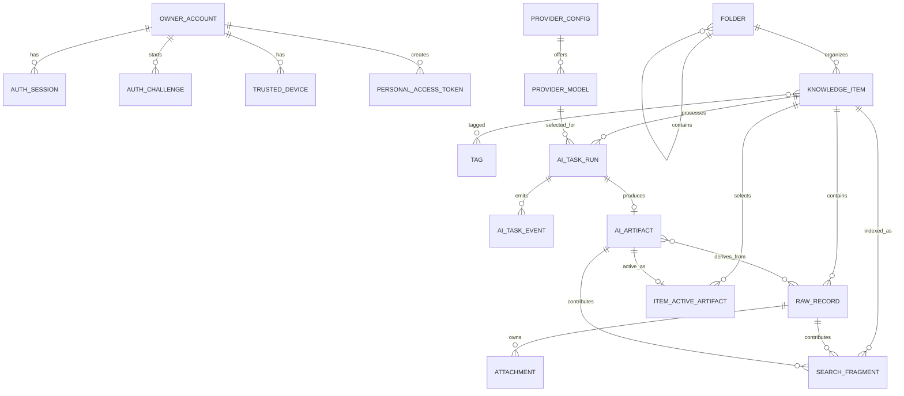

# 开发百宝箱一期数据模型

状态：**已完成并关闭，作为 `v1.0.0` 的冻结数据模型**

## 1. 建模原则

1. 原始事实和可变展示状态分开。
2. 人工元数据与 AI 派生结果分开。
3. 业务数据使用明确列；JSONB 只保存来源差异、模型结果和确实动态的配置。
4. 搜索索引、缩略图和 AI 结果都是可重建派生物。
5. 单用户不等于没有认证主体，但不为未来多租户在每张表增加租户字段。
6. 一期使用 PostgreSQL 外键、唯一约束和检查约束表达真实不变量，不构建事件溯源或 CQRS。

## 2. 关系概览



## 3. 身份与安全表

### 3.1 `owner_account`

实例只能有一行。数据库迁移必须使用唯一表达式索引或等价的简单约束保证这一点，不能只依赖初始化命令先查询再插入，也不为此增加 tenant 或 singleton 状态机。

| 字段 | 类型 | 说明 |
|---|---|---|
| `id` | UUID PK | 固定所有者 ID |
| `username` | text unique | 登录名 |
| `password_hash` | text | 密码哈希，不保存原密码 |
| `totp_secret_ciphertext` | bytea nullable | 启用 MFA 后保存加密 TOTP secret |
| `totp_enabled_at` | timestamptz nullable | 完成验证码确认的时间 |
| `password_changed_at` | timestamptz | 用于批量失效旧会话 |
| `created_at` | timestamptz | 初始化时间 |
| `updated_at` | timestamptz | 最近设置变更时间 |

不增加邮箱、手机号、姓名、角色、租户或状态机字段。

### 3.2 `auth_challenges`

只承载登录二次验证和 TOTP 绑定/重置这两个现实流程，不作为通用审批或工作流表。

| 字段 | 类型 | 说明 |
|---|---|---|
| `id` | UUID PK | 返回浏览器的不透明挑战 ID |
| `owner_account_id` | UUID FK | 已通过密码阶段的实例所有者 |
| `mode` | enum | `mfa_verify` / `totp_enroll` |
| `pending_totp_secret_ciphertext` | bytea nullable | enroll 模式的新 TOTP secret，加密保存 |
| `failed_attempts` | smallint | 最多 5 次，超限即失效 |
| `expires_at` | timestamptz | 创建后 5 分钟 |
| `consumed_at` | timestamptz nullable | 成功或明确作废后不可复用 |
| `created_at` | timestamptz | 创建时间 |

挑战只在密码已通过后创建。过期/已消费挑战不可恢复；清理任务可以物理删除 24 小时前的挑战。pending secret 不进入日志或普通 API 响应；同一未过期、未消费的 enroll challenge 重复调用 setup 时解密并返回同一个 pending secret，不生成新值。provisioning URI 与手动密钥响应必须使用 `Cache-Control: no-store`。

### 3.3 `mfa_recovery_codes`

| 字段 | 类型 | 说明 |
|---|---|---|
| `id` | UUID PK | 恢复码记录 |
| `code_hash` | text unique | 一次性恢复码哈希 |
| `used_at` | timestamptz nullable | 使用后不可再次使用 |
| `created_at` | timestamptz | 生成时间 |

重新生成恢复码时删除未使用旧码并创建新集合，不保存明文副本。

### 3.4 `auth_sessions`

| 字段 | 类型 | 说明 |
|---|---|---|
| `id` | UUID PK | 会话 ID |
| `token_hash` | bytea unique | Cookie 中随机令牌的哈希 |
| `csrf_token_hash` | bytea | 会话绑定 CSRF Token 的哈希 |
| `trusted_device_id` | UUID nullable FK | 本次会话是否来自可信设备 |
| `created_at` | timestamptz | 登录时间 |
| `last_seen_at` | timestamptz | 低频更新，避免每请求写库 |
| `expires_at` | timestamptz | 会话绝对到期时间 |
| `revoked_at` | timestamptz nullable | 主动撤销时间 |
| `client_ip` | inet nullable | 安全事件辅助，不作为设备身份 |
| `user_agent` | text nullable | 显示和诊断，限制长度 |

### 3.5 `trusted_devices`

| 字段 | 类型 | 说明 |
|---|---|---|
| `id` | UUID PK | 可信设备 ID |
| `token_hash` | bytea unique | 设备 Cookie 的随机令牌哈希 |
| `display_name` | text | 用户可识别名称，可修改 |
| `created_at` | timestamptz | 签发时间 |
| `last_used_at` | timestamptz | 最近使用 |
| `expires_at` | timestamptz | 创建后 90 天 |
| `revoked_at` | timestamptz nullable | 撤销时间 |

不使用浏览器指纹替代随机令牌，也不收集无必要的硬件属性。

### 3.6 `personal_access_tokens`

| 字段 | 类型 | 说明 |
|---|---|---|
| `id` | UUID PK | Token 记录 |
| `name` | text | 用户可识别名称 |
| `token_prefix` | text | 列表中识别 Token，不足以认证 |
| `token_hash` | bytea unique | 完整 Token 哈希 |
| `scopes` | text[] | 固定枚举集合 |
| `created_at` | timestamptz | 创建时间 |
| `last_used_at` | timestamptz nullable | 最近使用 |
| `expires_at` | timestamptz nullable | 可选到期时间 |
| `revoked_at` | timestamptz nullable | 撤销时间 |

约束：scope 只能来自一期定义集合，不能存任意权限字符串。

### 3.7 `idempotency_records`

只用于创建记录/附件的网络安全重试，不是通用请求缓存。

| 字段 | 类型 | 说明 |
|---|---|---|
| `actor_type` | enum | `session` / `pat` |
| `actor_id` | UUID | 对应会话或 PAT ID，由服务层校验 |
| `route_key` | text | 固定创建路由标识 |
| `idempotency_key` | text | 客户端每个逻辑操作生成的新键 |
| `created_item_id` | UUID FK ON DELETE CASCADE | 第一次成功创建或追加的目标条目 |
| `created_raw_record_id` | UUID nullable FK ON DELETE CASCADE | supplement 路由第一次成功创建的 raw record |
| `created_at` | timestamptz | 创建时间 |
| `expires_at` | timestamptz | 24 小时后可清理 |

复合主键 `(actor_type, actor_id, route_key, idempotency_key)`。只保存结果资源 ID，不保存或哈希原始正文/附件；创建 item 时由 `created_item_id` 恢复响应，添加 supplement 时同时使用 `created_item_id + created_raw_record_id`。重复键直接返回同一资源，调用者负责不复用逻辑操作键。

## 4. 知识与原始数据

### 4.1 `knowledge_items`

这是列表、目录和搜索结果中的主对象。

| 字段 | 类型 | 说明 |
|---|---|---|
| `id` | UUID PK | 条目 ID |
| `title` | text | 人工当前标题；未填写时由确定性摘要生成临时标题 |
| `title_origin` | enum | `generated` / `user` / `ai_applied` |
| `note` | text nullable | 简短人工备注，不是第二个正文编辑器 |
| `folder_id` | UUID nullable FK | 人工生效的主目录，空表示收件箱 |
| `sensitivity` | enum | `normal` / `sensitive` / `unknown` |
| `favorite` | boolean | 收藏 |
| `created_at` | timestamptz | 条目创建时间 |
| `updated_at` | timestamptz | 人工元数据或当前版本变更时间 |
| `deleted_at` | timestamptz nullable | 回收站标记 |

约束：

- `title` 去除首尾空白后非空，最多 200 个 Unicode 字符。
- `note` 最多 2,000 个 Unicode 字符。
- `deleted_at` 不触发原始内容物理删除。

### 4.2 `raw_records`

| 字段 | 类型 | 说明 |
|---|---|---|
| `id` | UUID PK | 原始记录 ID |
| `item_id` | UUID FK | 所属知识条目 |
| `record_role` | enum | `primary` / `supplement` / `migration_copy` |
| `source_type` | enum | `web_capture` / `browser_extension` / `api` / `notion_migration` / `wecom_migration` / `system` |
| `content_kind` | enum | `text` / `image` / `file` / `mixed` |
| `content_format` | enum | `plain_text` / `markdown` |
| `body` | text | 原始正文；文件-only 记录可为空字符串 |
| `declared_sensitivity` | enum | 创建时的 `normal` / `sensitive` / `unknown` |
| `captured_at` | timestamptz | 开发百宝箱接收时间 |
| `effective_captured_at` | timestamptz | 确定性派生并持久化的有效采集时间，用于索引和排序 |
| `source_external_id` | text nullable | Notion page ID 等 |
| `source_path` | text nullable | 原始目录链，纯来源信息 |
| `source_created_at` | timestamptz nullable | 外部系统创建时间 |
| `source_updated_at` | timestamptz nullable | 外部系统更新时间 |
| `source_time_quality` | enum | `exact` / `estimated` / `unknown` |
| `source_metadata` | jsonb | 有界来源元数据，不用于主业务查询 |
| `created_at` | timestamptz | 数据库写入时间 |

不可变列：`record_role`、`content_kind`、`body`、`content_format`、`captured_at`、`effective_captured_at`、来源字段和 `declared_sensitivity` 在产品与迁移工具中都不提供 UPDATE 路径。迁移发现错误时创建新的补充/替代 raw record 并建立关系，不能回写旧记录。`body` 最多 1 MiB UTF-8 字节；文件/图片-only 记录可以为空，其他记录去除首尾空白后必须非空。数据库层不创建阻止管理员灾难恢复操作的复杂触发器，但集成测试必须证明所有正常应用和迁移路径都无法修改这些列。

`effective_captured_at` 在创建时由服务端写死：`source_created_at` 非空且 `source_time_quality` 为 `exact` 或 `estimated` 时取 `source_created_at`，否则取 `captured_at`。条目级“最近”时间取其全部 raw record 的 `effective_captured_at` 最大值；UI 同时展示命中记录的时间来源与可信度，不能把迁移接收时间冒充原始时间。

`content_kind` 不接受客户端指定，由正文和所属附件确定：

- 仅有非空正文：`text`。
- 正文为空且附件全部为图片：`image`。
- 正文为空且附件全部为普通文件：`file`。
- 正文与任意附件并存，或图片与普通文件并存：`mixed`。

每个 item 必须随创建事务产生一个 primary raw record，并使用 `WHERE record_role = 'primary'` 的部分唯一约束或等价数据库约束保证同一 item 至多一个 primary；supplement 与 migration copy 不受该唯一约束影响。

`knowledge_items.sensitivity` 是当前访问/外发策略值；`raw_records.declared_sensitivity` 只记录采集当时声明。新增 supplement 时按 `sensitive > unknown > normal` 与 item 当前值取更严格者，同一事务只允许自动升级、不自动降级；升级时若 `title_origin=generated`，同时换成安全通用标题。用户之后仍可显式改判并写入不含正文的 `security_events`，历史声明不变；AI 只能建议。升级立即作用于展示、PAT 和后续 AI 输入，旧 Artifact 不删除，只按下文规则变为 stale。

`source_metadata` 允许的典型字段：

- `sourceApplication`：剪贴板来源应用，最多 120 字符。
- `importBatchId`：迁移批次 ID，最多 120 字符。
- `originalUrl`：原始 HTTP(S) 页面 URL，最多 2,048 字符。
- `exportRelativePath`：原始导出文件相对路径，最多 2,048 字符。
- `parentExternalId`：原始父页面 ID，最多 500 字符。
- `sequence`：同一来源中的非负顺序号。

一期拒绝其他键、嵌套对象以及目录、标签、当前 AI 状态等正式业务字段。完整源系统导出需要保留时作为原始附件存储，不把任意大 JSON 塞进该列。

当 `source_external_id` 非空时，`(source_type, source_external_id)` 使用部分唯一约束。外部调用者必须把工具/工作区命名空间编码进 external ID；重复导入返回已存在记录，不覆盖其原文。`captured_at` 始终由开发百宝箱生成。

### 4.3 `raw_record_relations`

用于表达补充、替代和迁移重复，不承担通用知识图谱功能。

| 字段 | 类型 | 说明 |
|---|---|---|
| `from_record_id` | UUID FK | 新记录/候选记录 |
| `to_record_id` | UUID FK | 被补充/被替代/相似记录 |
| `relation_type` | enum | `supplements` / `supersedes` / `migration_duplicate` |
| `origin` | enum | `user` / `migration` / `ai_suggestion` |
| `confirmed` | boolean | AI 建议是否经用户确认 |
| `created_at` | timestamptz | 建立时间 |

唯一约束：同一 from/to/type 只能有一条；禁止自关联。`supplements` 与 `supersedes` 的两端必须属于同一 item，`migration_duplicate` 可以跨 item；由创建事务校验并用直接数据库约束或集成测试锁定，不扩展为通用知识图谱规则。

### 4.4 标题生成

快速录入未填写标题时，API 使用确定性规则立即生成：

1. 敏感/未知条目使用“敏感记录 · 本地时间”，不从正文提取，以免列表标题泄露密码或 Token。
2. normal 文本使用第一行非空文本，去除 Markdown 标记，过长时按 200 字符上限截断并加省略号。
3. normal 文件-only 使用安全 `display_name`。
4. normal 图片-only 使用“图片记录 · 本地时间”。

AI 后续可以建议标题，但不能让保存等待模型。

条目从 normal 改为 sensitive/unknown 时，如果 `title_origin=generated`，同一事务把标题换成安全通用标题；用户或用户采纳 AI 后明确设置的标题保持不变。列表可以显示人工标题、目录、标签和时间，正文/AI 摘要仍遮挡。

### 4.5 固定视图与时间

固定视图是服务端查询，不保存额外状态：

- `inbox`：`deleted_at IS NULL` 且 `folder_id IS NULL`。
- `recent`：`deleted_at IS NULL`，按条目下 raw record 的最大 `effective_captured_at` 倒序，再按 item ID 倒序稳定排序。
- `favorites`：`deleted_at IS NULL` 且 `favorite = true`。
- `sensitive`：`deleted_at IS NULL` 且 `sensitivity IN ('sensitive', 'unknown')`。
- `images`：`deleted_at IS NULL` 且存在 `status=ready` 的图片附件。
- `files`：`deleted_at IS NULL` 且存在 `status=ready` 的普通文件附件。
- `trash`：`deleted_at IS NOT NULL`。

同一混合条目可以同时出现在 images 与 files。不得为这些视图增加 `processed`、`archived`、`inbox_status` 或 item 级 `content_kind` 字段。

## 5. 目录与标签

### 5.1 `folders`

| 字段 | 类型 | 说明 |
|---|---|---|
| `id` | UUID PK | 目录 ID |
| `parent_id` | UUID nullable FK | 根目录为空 |
| `name` | text | 同级显示名 |
| `sort_order` | integer | 用户排序 |
| `created_at` | timestamptz | 创建时间 |
| `updated_at` | timestamptz | 修改时间 |

约束：

- 同一 parent 下名称忽略大小写唯一。
- 根目录与非根目录分别使用部分唯一索引表达忽略大小写唯一，避免 `parent_id IS NULL` 绕过普通复合唯一约束。
- API 检测移动造成的循环。
- 名称最多 80 个 Unicode 字符，目录最多 8 层。
- 一期不保存无限物化路径；查询时使用递归 CTE，个人规模足够。
- API 与 UI 都拒绝创建或移动到第 9 层；数据库仍使用简单父引用和递归 CTE，不增加物化路径编码。

### 5.2 `tags`

| 字段 | 类型 | 说明 |
|---|---|---|
| `id` | UUID PK | 标签 ID |
| `name` | text | 忽略大小写唯一 |
| `created_at` | timestamptz | 创建时间 |

标签名称最多 40 个 Unicode 字符；同一条目最多正式应用 30 个标签。

### 5.3 `item_tags`

复合主键 `(item_id, tag_id)`，另含 `created_at`。只有已正式应用的标签进入此表，AI 未采纳建议只存在 artifact JSON 中。

## 6. 附件

### 6.1 `attachments`

| 字段 | 类型 | 说明 |
|---|---|---|
| `id` | UUID PK | 附件 ID |
| `raw_record_id` | UUID FK | 所属原始记录 |
| `kind` | enum | `image` / `file` |
| `original_name` | text | 客户端报告的原始 base name，最多 1,024 字符，作为来源事实保留 |
| `display_name` | text | 去除控制字符/路径语义后的显示下载名，最多 255 字符 |
| `storage_key` | text unique | 系统生成的卷内相对路径 |
| `client_media_type` | text nullable | 客户端声明值，只用于来源诊断，不决定行为 |
| `media_type` | text | 服务端检测结果，决定 kind、预览和响应类型 |
| `content_sha256` | bytea | 上传流中同步计算的 32 字节内容摘要 |
| `size_bytes` | bigint | 实际大小，0–20 MiB |
| `width` | integer nullable | 可解码图片宽度 |
| `height` | integer nullable | 可解码图片高度 |
| `status` | enum | `ready` / `missing` / `pending_delete` |
| `created_at` | timestamptz | 创建时间 |

原始附件没有覆盖接口。替换文件意味着新建补充原始记录和新附件。`content_sha256` 只供完整性检查和恢复时逐项校验使用；不用于全局去重、秒传、内容寻址或生成存储路径。

### 6.2 `attachment_derivatives`

只为已有消费者保存可重建文件，例如缩略图。

| 字段 | 类型 | 说明 |
|---|---|---|
| `id` | UUID PK | 派生文件 ID |
| `attachment_id` | UUID FK | 原图 |
| `kind` | enum | 一期只有 `thumbnail` |
| `storage_key` | text unique | 派生文件路径 |
| `media_type` | text | 输出 MIME |
| `size_bytes` | bigint | 大小 |
| `created_at` | timestamptz | 生成时间 |

派生文件丢失可以重建，不阻止恢复判定。

## 7. AI Provider 与模型

### 7.1 `provider_configs`

| 字段 | 类型 | 说明 |
|---|---|---|
| `id` | UUID PK | 配置 ID |
| `provider_key` | text unique | 稳定小写 ID，创建后不变 |
| `display_name` | text | 界面名称 |
| `protocol` | enum | `openai-completions` / `openai-responses` / `anthropic-messages` |
| `base_url` | text | 默认 HTTPS；只有部署显式允许时接受 HTTP 内网网关 |
| `api_key_ciphertext` | bytea nullable | 活动配置必填；软删除后清除 |
| `enabled` | boolean | 是否可领取任务 |
| `deleted_at` | timestamptz nullable | 删除配置但保留历史引用 |
| `created_at` | timestamptz | 创建时间 |
| `updated_at` | timestamptz | 修改时间 |

加密所需 nonce/版本可以和密文封装在一个版本化 envelope 中，不拆成用户可编辑字段。

### 7.2 `provider_models`

| 字段 | 类型 | 说明 |
|---|---|---|
| `id` | UUID PK | 内部模型配置 ID |
| `provider_config_id` | UUID FK | 所属 Provider |
| `model_id` | text | Provider 请求使用的模型 ID |
| `display_name` | text | 界面名称 |
| `context_window` | integer nullable | 用户配置或发现值 |
| `max_output_tokens` | integer nullable | 用户配置或发现值 |
| `supports_tools` | boolean | 是否允许受控 Agent 工具调用 |
| `supports_vision` | boolean | 能否处理图片 |
| `enabled` | boolean | 是否可选 |
| `deleted_at` | timestamptz nullable | 删除后不再用于新任务 |
| `created_at` | timestamptz | 创建时间 |
| `updated_at` | timestamptz | 修改时间 |

唯一约束 `(provider_config_id, model_id)`。

删除 Provider 是软删除：先确认没有 queued/running 任务，再禁用 provider/models、清空加密 Key、清除默认模型设置并写 `deleted_at`。历史 task/artifact 的模型快照和外键继续可读；一期不复用已删除的 `provider_key`。

## 8. AI 任务与派生版本

### 8.1 `ai_task_runs`

| 字段 | 类型 | 说明 |
|---|---|---|
| `id` | UUID PK | 任务 ID |
| `task_type` | enum | 四种一期任务 |
| `item_id` | UUID nullable FK | 单条任务目标；批任务为空 |
| `parent_task_id` | UUID nullable FK | batch 子任务关系 |
| `trigger_type` | enum | `manual` / `scheduled` / `external` |
| `schedule_key` | text nullable | 例如 `daily:2026-08-29`，防止同一时间窗重复创建 |
| `model_id` | UUID nullable FK | 非 batch 任务冻结到具体模型；batch 父任务为空，子任务各自保存 |
| `status` | enum | `queued` / `running` / `succeeded` / `failed` / `cancelled` |
| `sensitive_policy` | enum | `block` / `redact` / `allow` |
| `prompt_version` | text | 运行时 Prompt 版本 |
| `schema_version` | text | 期望输出 Schema |
| `input_snapshot` | jsonb | 原始记录 ID、片段 ID、附件 ID及版本，不复制全文 |
| `retry_of_task_id` | UUID nullable FK | 用户手动重试所基于的失败/取消任务 |
| `claim_attempt` | smallint | worker 领取次数，最多 2（首次 + 一次租约恢复） |
| `lease_owner` | text nullable | 当前 worker 实例标识，不是用户身份 |
| `lease_expires_at` | timestamptz nullable | worker 失联后的恢复边界 |
| `heartbeat_at` | timestamptz nullable | 最近任务心跳 |
| `queued_at` | timestamptz | 入队时间 |
| `started_at` | timestamptz nullable | 开始时间 |
| `finished_at` | timestamptz nullable | 完成时间 |
| `cancel_requested_at` | timestamptz nullable | 用户取消请求 |
| `error_code` | text nullable | 稳定错误码 |
| `error_detail` | text nullable | 脱敏诊断摘要 |
| `batch_summary` | jsonb nullable | 仅 batch 父任务：选中 item、子任务状态和按固定原因跳过的计数 |
| `input_tokens` | bigint nullable | Provider 报告值 |
| `output_tokens` | bigint nullable | Provider 报告值 |

`input_snapshot` 只保存 ID、版本和任务边界，不复制正文或图片字节。服务端据此计算 Artifact 的 `isStale`，不增加数据库状态字段：`organized_record` 与 `correctness_review` 比较当前 raw record ID 集合，`image_analysis` 比较当前 ready 图片附件 ID 集合。集合变化后旧结果变为 stale，但不自动失效、删除或切换版本；当前激活 Artifact 的搜索片段也不会仅因 stale 被停用。调度器将其视为待重建，API/UI 必须持续标记“未覆盖最新原始记录”。外部 Agent 提交 artifact 时，API 同样创建一条 `trigger_type=external` 的已完成任务来源记录并保存其受控输入快照。

`batch_summary` 使用固定结构：`selectedItems`、`createdChildren`、`childStatusCounts` 和 `skipped`。`childStatusCounts` 仅含五种任务状态且总和等于 `createdChildren`；`skipped.total` 等于 `skipped.byReason` 各值之和。允许的跳过原因只有 `already_covered`、`already_queued_or_running`、`no_supported_content`、`vision_model_unavailable`、`sensitive_blocked`、`sensitive_image_redaction_unsupported`。一个混合 item 可以产生两个子任务，因此 item 数与分支数不要求相等；不把自由文本错误塞入摘要。

batch 有子任务时父任务进入 `running`；每次子任务状态变化时，API 在同一事务更新或从子任务重算 `childStatusCounts`。全部子任务终止后，父任务若自身已有取消请求则 cancelled；否则按 `failed > cancelled > succeeded` 聚合：任一失败则 failed；无失败但任一取消则 cancelled；其余 succeeded。skip 不单独导致失败；零子任务且所有输入均有稳定 skip reason 时直接 succeeded。父任务收到取消后不再创建子任务，queued 子任务立即 cancelled，running 子任务设置 `cancel_requested_at`；全部子任务终止后父任务进入 cancelled，已经成功的子任务与 Artifact 保留。

状态转换：

```text
queued → running → succeeded
             ├──→ failed
             └──→ cancelled
queued ──────────→ cancelled
running ──租约过期、无取消请求且只领取过一次──→ queued
running ──租约过期且已有取消请求──────────→ cancelled
```

除 `batch_organize` 父任务外，成功状态必须关联合法 artifact；batch 父任务由 API 创建子任务并根据子任务终态汇总，不产生 artifact，也不由 worker 领取。Schema 校验失败只能是 `failed`。租约过期后最多重新排队一次，第二次租约仍过期则失败。用户点击“重试”创建新的 task row 并填写 `retry_of_task_id`，不把旧失败任务改回 queued。

`schedule_key` 在 scheduled batch 上使用部分唯一约束，API 重启或时钟重复不能为同一日/周时间窗创建第二个 batch。一次定期 batch 最多选择 20 个 item；同一 item 同时有正文和待分析图片时，可以各创建一个 `organize_record` 与 `analyze_image` 子任务。

单条任务使用 PostgreSQL 部分唯一索引保证同一 `item_id + task_type` 同时最多存在一个 `queued`/`running` row；batch 父任务的 `item_id` 为空，不受此约束。lease 恢复只处理 `cancel_requested_at IS NULL` 的任务；已有取消请求的失联任务直接 cancelled，不能重新排队。

worker complete 先按 `task_run_id` 查询已有 Artifact：若存在且任务已 succeeded，验证请求仍对应原成功 lease 后直接返回原 Artifact 和终态。只有 Artifact 不存在时，才在创建事务中校验当前 lease、任务仍为 running 且 `cancel_requested_at IS NULL`，然后分配版本、写 Artifact 并把任务置为 succeeded；取消先发生则不得创建 Artifact。`ai_artifacts.task_run_id UNIQUE` 承担该窄幂等，不建立通用完成框架。

### 8.2 `ai_task_events`

| 字段 | 类型 | 说明 |
|---|---|---|
| `id` | bigserial PK | 单调事件序号 |
| `task_id` | UUID FK | 任务 |
| `event_type` | enum | 架构文档定义的阶段事件 |
| `summary` | text nullable | 脱敏的人类可读摘要 |
| `details` | jsonb | token、耗时、工具名等有限字段 |
| `created_at` | timestamptz | 时间 |

不保存每个 token delta。任务事件默认保留 30 天；任务最终状态和 artifact 长期保留。保留期是运维清理，不影响用户内容。

### 8.3 `ai_artifacts`

| 字段 | 类型 | 说明 |
|---|---|---|
| `id` | UUID PK | 派生版本 ID |
| `item_id` | UUID FK | 所属条目 |
| `task_run_id` | UUID unique FK | 产生任务；外部提交也创建对应任务来源记录 |
| `artifact_type` | enum | `organized_record` / `correctness_review` / `image_analysis` |
| `version_number` | integer | 条目同一 artifact type 内单调版本 |
| `schema_version` | text | JSON Schema 版本 |
| `content` | jsonb | 通过 Schema 校验的完整结果 |
| `generator` | enum | `builtin_worker` / `external_agent` / `migration` |
| `model_name` | text nullable | 生成模型/Agent 标识快照 |
| `prompt_version` | text nullable | Prompt 版本 |
| `created_at` | timestamptz | 创建时间 |
| `invalidated_at` | timestamptz nullable | 人工作废，不物理覆盖 |

唯一约束 `(item_id, artifact_type, version_number)`。版本号在锁定 item row 或等价的小事务中分配，不创建独立版本服务。

### 8.4 `item_active_artifacts`

一个条目可以同时拥有当前整理、当前正确性审阅和当前图片分析，不能让三种结果互相覆盖。

| 字段 | 类型 | 说明 |
|---|---|---|
| `item_id` | UUID FK | 条目 |
| `artifact_type` | enum | 三种 artifact type |
| `artifact_id` | UUID unique FK | 当前激活版本 |
| `activated_at` | timestamptz | 用户或允许的自动规则激活时间 |

复合主键 `(item_id, artifact_type)`。`artifact_id` 必须属于同一 item、同一 type 且未作废；由服务层在事务中校验。内置 `organized_record` 的成功后自动激活遵循用户设置，内置 `image_analysis` 成功后自动激活，`correctness_review` 与所有外部 Agent 结果默认保持候选，直到用户激活。

作废当前 artifact 时，同一事务删除对应 active row 并停用其搜索片段；系统不擅自回退到更旧版本，用户可以明确选择未作废的旧版本重新激活。已作废版本只能查看。

### 8.5 `artifact_sources`

复合主键 `(artifact_id, raw_record_id)`，用于明确一个结果基于哪些原始记录。raw record 必须属于 artifact 的同一 item；可选保存 `fragment_ids` UUID[]，且每个 fragment 必须属于对应 raw record。相关记录可帮助模型分类，但不进入正式证据关系，避免跨条目删除和敏感边界耦合。

## 9. 搜索索引

### 9.1 `search_fragments`

| 字段 | 类型 | 说明 |
|---|---|---|
| `id` | UUID PK | 片段 ID，也是 AI 引用证据 ID |
| `item_id` | UUID FK | 所属条目 |
| `raw_record_id` | UUID nullable FK | 原始来源 |
| `artifact_id` | UUID nullable FK | AI 来源 |
| `source_kind` | enum | `title` / `metadata` / `raw_text` / `code` / `filename` / `ai_text` / `image_text` |
| `ordinal` | integer | 在来源中的顺序 |
| `fragment_version` | smallint nullable | 确定性分片算法版本；原始片段必填 |
| `start_byte` | integer nullable | 在不可变 raw body 中的 UTF-8 起始字节 |
| `end_byte` | integer nullable | UTF-8 结束字节（不含），用于定位原文 |
| `content` | text | 用于高亮和引用的片段原文/派生文 |
| `normalized_content` | text | 统一空白与大小写后的检索文本 |
| `search_vector` | tsvector | `simple` 配置生成的 token 向量 |
| `weight` | smallint | 固定权重枚举，而非任意浮点调参 |
| `active` | boolean | 当前 artifact 或有效来源是否参与普通搜索 |
| `created_at` | timestamptz | 生成时间 |

来源约束：

- `raw_text`/`code` 必须有 `raw_record_id`。
- `ai_text`/`image_text` 必须有 `artifact_id`。
- 标题/元数据可以只关联 `item_id`。
- 不允许 raw 与 artifact 同时作为同一片段来源。
- AI artifact 的 `sourceFragmentIds` 只能引用 raw record 的 `raw_text`/`code` 片段，不能把 AI 派生文本当原始证据。

索引建议：

- `GIN (normalized_content gin_trgm_ops)`。
- `GIN (search_vector)`。
- `(item_id, active)`。
- `(raw_record_id, fragment_version, ordinal)` 唯一、`(artifact_id, ordinal)`。
- 过滤字段仍从 item/folder/tag 表查询，不把所有字段冗余进 JSON。

### 9.2 分片规则

分片过程按内容格式确定：

- Markdown 标题开启新段。
- fenced code block 独立成为 `code` 片段。
- 普通段落在不跨标题/代码边界的前提下合并，目标不超过 4 KiB UTF-8，硬上限 8 KiB。
- 纯文本连续非空行按段落组处理。
- 过长单段/代码块优先在换行处分割；单行本身超过 8 KiB 时才按 UTF-8 字符边界硬分割。详情复制始终读取原始正文，不拼搜索片段。
- V1 不做重叠窗口；命中定位依赖每片段的原始字节范围。
- `normalized_content` 只做 Unicode 小写、换行/空白统一和首尾空白去除，不删除标点、路径分隔符或命令符号。

原始片段 ID 使用固定 namespace 的 UUIDv5，由 `raw_record_id + fragment_version + ordinal` 生成；这里的确定性 ID 是为了让 artifact 引用在同版本重建后仍指向同一证据，不对内容做去重或安全哈希。

标题、人工元数据和 AI 派生搜索片段会随编辑、激活或作废变化，没有稳定证据引用消费者，使用普通随机 UUID 并按来源替换，不扩展 UUIDv5 规则。

分片算法需要版本号。算法升级时为原始记录生成新版本片段并原子切换搜索 active 状态，不改 `raw_records.body`；被历史 artifact 引用的旧版本片段继续保留用于定位。受控重建同一版本时 upsert 相同 ID，不让引用漂移。

## 10. 设置与安全事件

### 10.1 `app_settings`

只保存实例级低频设置：

| key | 示例值 |
|---|---|
| `theme_default` | `dark` |
| `sensitive_display_mode` | `masked` |
| `sensitive_ai_policy` | `redact` |
| `scheduled_organize` | `off` / `daily` / `weekly` |
| `schedule_timezone` | IANA 时区，例如 `Asia/Shanghai` |
| `schedule_local_time` | `HH:mm`，默认 `03:00` |
| `schedule_weekday` | 1–7；仅 weekly 使用，默认 1（周一） |
| `default_organize_model_id` | UUID |
| `default_review_model_id` | UUID |
| `default_vision_model_id` | UUID |

实现可以采用有类型的单行设置表，而不是任意 key/value；上表表达业务字段而非要求通用配置中心。

### 10.2 `security_events`

只记录对用户有实际价值的安全事件：登录成功/失败、MFA 恢复码使用、密码/TOTP 变更、可信设备和 PAT 创建/撤销。

字段：事件类型、时间、服务端按可信代理规则解析的请求 IP、User-Agent 摘要和脱敏详情。精确 IP 只在数据库会话/安全事件中保留，默认最多 90 天；普通 stdout/stderr HTTP 日志不记录完整 IP。任何位置都不记录原始内容或模型 Prompt。

## 11. 核心事务

### 11.1 创建纯文本记录

同一数据库事务：

1. 创建 `knowledge_items`。
2. 创建 `raw_records`。
3. 创建标题/原始文本搜索片段。
4. 提交。

保存事务不自动创建 AI 任务。手动或定期任务在记录提交后使用独立事务创建，失败不改变原始记录。

### 11.2 创建带附件记录

1. 在附件卷同一文件系统中流式写临时文件，同时计算 SHA-256，校验 20 MiB 单文件限制并关闭文件。
2. 检查服务端媒体类型和图片信息，并保留有界的客户端声明 MIME 供诊断。
3. 开启数据库事务，创建 item、raw record、attachment 和搜索片段。
4. 在提交事务前把临时文件原子移动到最终 storage key；移动失败则回滚事务。
5. 移动成功后提交事务。提交失败或进程在移动后崩溃时，最终文件可能成为无数据库引用的孤儿，由完整性检查报告并由显式运维命令清理。

不把整个文件读入内存，也不让数据库保存大二进制。这个顺序保证正常完成的数据库记录一定已经有最终文件；故障最多产生孤儿文件，不产生已提交但缺少原件的记录。

向已有 item 添加带附件 supplement 复用同一文件事务，只是不创建新 item，并在数据库事务内同时创建 supplement raw record、relation、附件、搜索片段以及必要的 item sensitivity/title 升级。

### 11.3 添加补充记录

1. 锁定目标 item 并确认未在回收站。
2. 按纯文本或附件流程创建 immutable supplement raw record；可选 relation 的目标必须符合 4.3 节。
3. 按 `sensitive > unknown > normal` 合并 sensitivity，并在需要时安全化系统标题。
4. 提交后旧 Artifact 通过输入集合计算为 stale，不更新或删除其内容。

### 11.4 激活 AI 版本

同一事务：

1. 校验 artifact 属于 item 且未作废。
2. 按 artifact type upsert `item_active_artifacts`，不改变其他 type 的当前版本。
3. 将同一 type 的旧 artifact 搜索片段设为 inactive，新版本设为 active。
4. 提交。

不修改 raw record、目录或正式标签。

### 11.5 永久删除

1. 要求 item 已在回收站，并通过用户明确确认。
2. 开启数据库事务，把附件移动到卷内隔离删除区，再删除 artifact、任务关联、索引、标签关联、raw record 和 item。
3. 数据库提交后删除隔离文件；删除失败只留下无数据库引用的隔离文件，由运维清理命令处理。
4. 事务回滚时尝试把隔离文件移回原 storage key；进程中断时，启动完整性检查根据仍存在的数据库引用恢复隔离文件并阻止该条目下载，直到恢复完成。

一期不构建复杂通用 Saga，这个流程仅服务真实的数据库+文件双写边界。

## 12. 一次性迁移支持

一期产品不提供 Notion 导入 UI，但数据模型必须允许后续一次性迁移：

- 每个 Notion 页面创建独立 `raw_record`。
- 保存外部 page ID、原始层级路径和可得时间。
- 图片下载为本地 attachment。
- 自动整理页和原始页都保留；疑似重复只建立 `migration_duplicate` 关系。
- 缺失图片创建 `status=missing` 的附件元数据或迁移问题记录，不静默删除引用。
- 真实迁移映射和错误清单存部署数据目录，不提交 Git。

## 13. 数据模型禁止事项

- 不用一个万能 `documents` JSONB 表承载全部业务。
- 不将模型输出字段平铺进原始记录。
- 不把人工目录直接交给模型覆盖。
- 不因为单用户就把密码、TOTP、PAT 明文保存。
- 不为未来多租户增加 `tenant_id`、角色表和权限矩阵。
- 不为未来语义搜索提前增加空 embedding 列或 pgvector 扩展。
- 不把附件正文、模型 Prompt 或完整响应塞进日志表。
- 不创建未被一期流程消费的审计链、事件存储或数据血缘系统。
